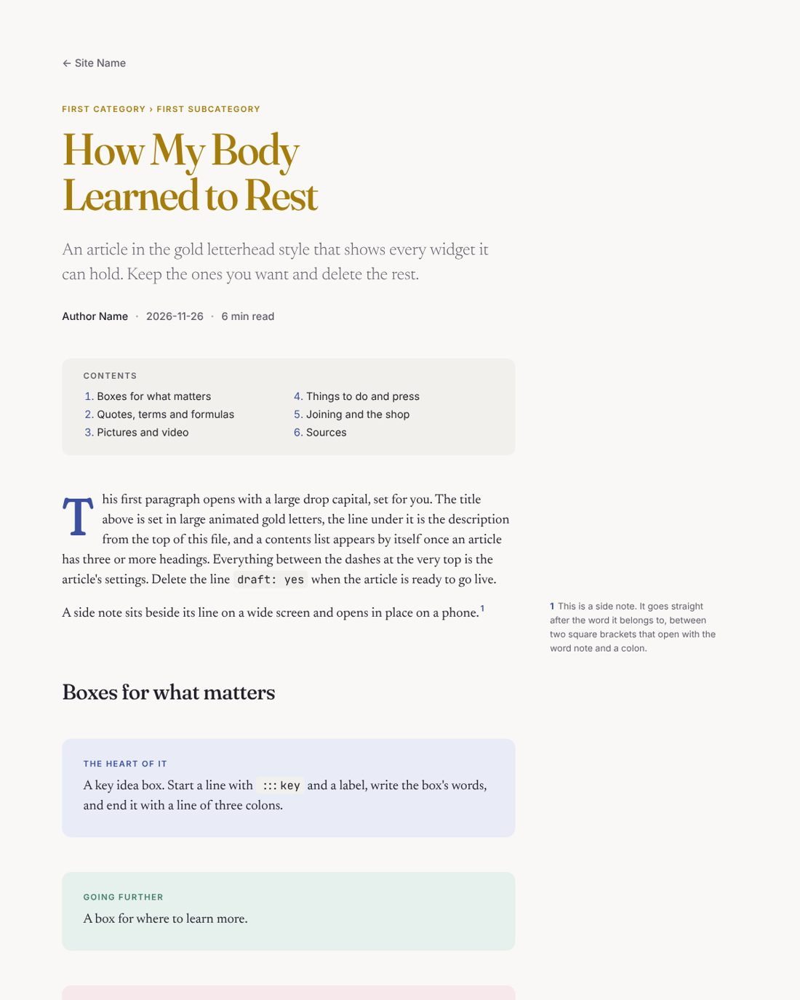
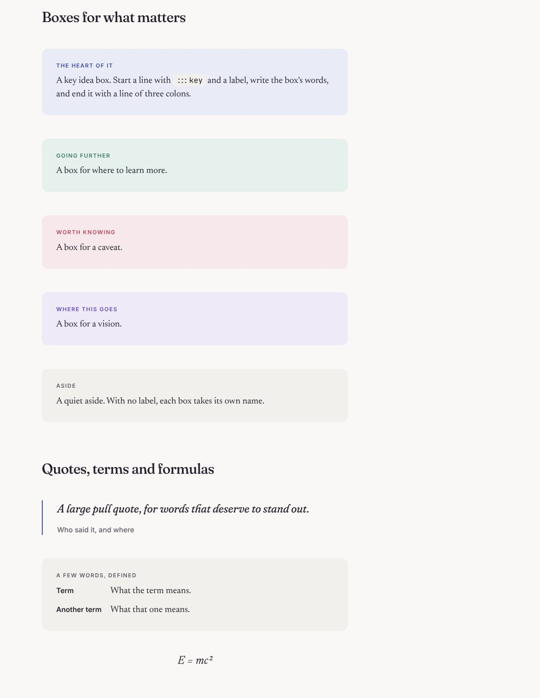
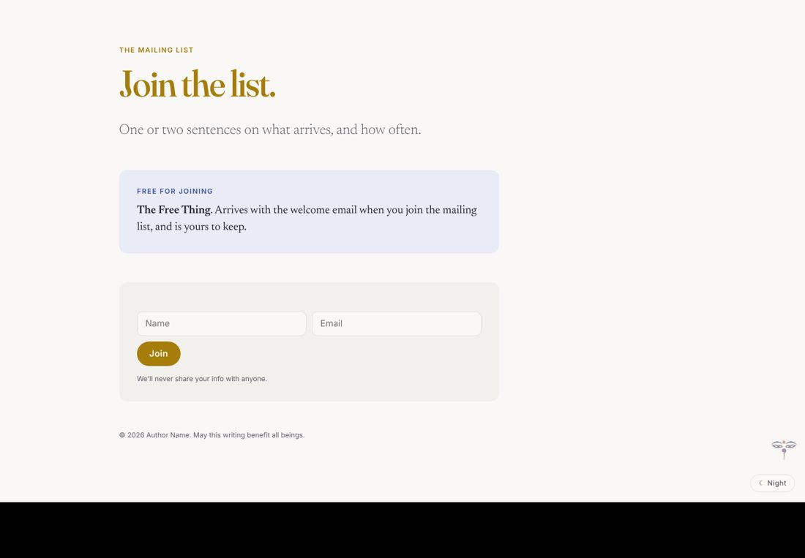
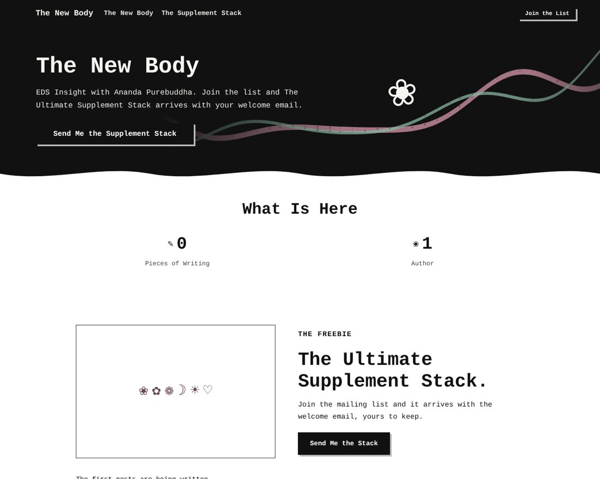
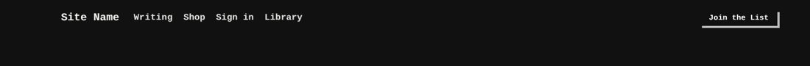

# Make your own, with no code

This repository makes websites from plain words. Everything here can be
done by pressing buttons on GitHub's website, or by double-clicking a
file on the PC, or by asking Claude. Nothing needs to be programmed.

**What do you want to make?**

| You want | Go to |
|---|---|
| An article, in the gold letterhead style, full of widgets | [A new article](#a-new-article) |
| A mailing list signup page, one short page and nothing else | [A signup page](#a-signup-page) |
| A blog with a mailing list | [A blog with a mailing list](#a-blog-with-a-mailing-list) |
| A blog with a mailing list and sign in | [A blog with sign in](#a-blog-with-a-mailing-list-and-sign-in) |
| Any of these as its own website, at its own address | [Going live](#going-live-as-its-own-website) |
| Any of these from one description, with nothing to set | [The easiest way](#the-easiest-way-one-box-and-one-button) |

## The easiest way, one box and one button

In the **Smile Client**, open **Site Maker**. Write what you would like,
in your own words, for example *"A signup page for my yoga newsletter,
Morning Tide. The gift for joining is a free 7-day morning practice. Calm
sea colours."* Press **Make it**. About a minute later the whole site is
there: every setting set, its colours and design chosen, its words
written, its article laid out with its widgets. Write more words and
press **Change it** to change anything. Press **Put it online** and it
becomes its own website.

Underneath, the Site Maker writes the same files the rest of this guide
describes, so anything it makes can also be changed by hand.

## The three ways to press a button

- **On GitHub's website.** Open the **Actions** tab at the top of this
  repository. On the left are the buttons: *New article*, *New site*,
  *Export a site*, *Export a post to Ghost*. Click one, press **Run
  workflow**, fill in the boxes, press the green **Run workflow**. When it
  finishes (about half a minute), click the run, and its summary has a
  link straight to what was made.
- **On the PC.** Double-click `New Article.bat` or `New Site.bat` in this
  folder and answer its question. `Build a Site.bat` shows a site in the
  browser: drag a site's folder onto it, or double-click it for this one.
- **Ask Claude.** "Make a new article called …", "Make a signup page for
  …". Claude reads this file and does the same.

Writing and changing anything afterwards is done in GitHub's website
too: open the file, press the **pencil** at its top right, write, and
press **Commit changes**. The site rebuilds and publishes itself.

## A new article

1. Press **Actions → New article → Run workflow**. Type the title. Leave
   *Which site* as `.` for this site, or give a site folder such as
   `sites/the-new-body`. Press **Run workflow**.
2. Open the finished run and press **Open it and write it here**.
3. The article arrives already holding every widget, each one with its
   own instructions in it. Keep the ones you want, delete the rest, and
   write.
4. Delete the line `draft: yes` near the top when it is ready, and press
   **Commit changes**. It goes live.

The settings at the very top of the article, between the two lines of
dashes, are its title, description, date, reading time, category (one of
the site's own, from its `site.toml`), glyph, project and tags. The line
`style: article` gives it the gold letterhead page.

### Every widget, and how to write it

| Widget | Write this |
|---|---|
| A key idea box | a line `:::key Your label`, then the words, then a line `:::` |
| Learn more, caveat, vision and aside boxes | the same, with `:::learn`, `:::caveat`, `:::vision`, `:::aside` |
| A large pull quote | `:::quote Who said it`, the words, then `:::` |
| Words with their meanings | `:::terms A label`, then lines like `Term: what it means`, then `:::` |
| A formula, centred | `:::math`, the formula, then `:::` |
| A section that opens when pressed | `:::more What it is called`, the words, then `:::` |
| A side note beside its line | `[[note: the note]]` straight after the word it belongs to |
| A picture with a caption | `` on its own line, the picture in the site's `site-assets/` folder |
| A video | `[[video: the YouTube or Vimeo address \| a caption]]` on its own line |
| A button | `[[button: The words on it \| the address it opens]]` on its own line |
| A checklist readers tick | lines starting `- [ ]`; a reader's ticks are remembered in their browser |
| A table | rows of words between `\|` marks, as in the example article |
| An ornament between parts | a line of three dashes, `---` |
| A mailing list form | `[[join: a-tag \| The heading \| The button]]` on its own line |
| The shop | `[[shop]]` on its own line |
| Numbered sources | a heading `## Sources` with a numbered list under it |

These come by themselves: the large animated gold title, the drop
capital, the contents list (three or more headings), the reading
progress bar, the night mode button, the author card, More reading, the
mailing list form at the end, and the Buddha eyes.

A post without `style: article` is set in the site's own blog style
instead, the same as most posts on drthomasager.com.

## A signup page

One short page: a heading, a few words, the free gift for joining, the
form, and nothing else.

1. Press **Actions → New site → Run workflow**. Give it a short name,
   choose **signup**, press **Run workflow**.
2. Open the finished run and press **Open its settings and fill them
   in**. Change the words under `[site]`, `[signup]` and the one
   `[[products]]` (the free gift). Put the mailing list's address in
   `endpoint` under `[mailing]` (see [The mailing list](#the-mailing-list)).
   Press **Commit changes**.
3. [Go live](#going-live-as-its-own-website).

## A blog with a mailing list

Home page, categories, articles, the mailing list in the popup and
footer, a shop, and a free gift for joining. The same as
drthomasager.com, with your own words and colours.

1. Press **Actions → New site → Run workflow**. Give it a short name,
   choose **blog**, press **Run workflow**.
2. Open the finished run and press **Open its settings and fill them
   in**. Every setting has a note beside it saying what it does: the
   site's name, the colours, the categories, the home page words, the
   shop, the free gift. Press **Commit changes**.
3. Write articles with **New article**, giving the site's folder.
4. [Go live](#going-live-as-its-own-website).

## A blog with a mailing list and sign in

1. Press **Actions → New site → Run workflow**, choose
   **blog-with-logins**, and fill in its settings as for a blog.
2. Under `[logins]` in its settings, give the address of the sign in
   page (`url`) and of the library of what a person has unlocked
   (`library_url`). *Sign in* and *Library* appear in the site's menu.

A website made of pages, like this one, cannot hold accounts and
passwords itself, so sign in lives in a service beside it. The ways to
have one:

- **Ghost** (ghost.org, hosted, or on your own server) has sign in,
  members, a mailing list and paid tiers built in, with no code. Carry
  articles into it with **Actions → Export a post to Ghost**, then in
  Ghost Admin, *Settings → Advanced → Import/Export → Import content*.
  DrThomasAger's Ghost theme in this style lives on the PC, in the Ghost
  Trial project's `content\themes\blog-template`.
- **The DrThomasAger account service** runs on the PC from
  `platform\accounts\`, with sign in, a password page and the library.
  It is not in this repository.

## Going live as its own website

1. Press **Actions → Export a site → Run workflow**, give the site's
   folder (e.g. `sites/the-new-body`), press **Run workflow**.
2. Open the finished run, scroll to **Artifacts**, and download the zip.
   Unzip it.
3. On GitHub, press **+** at the top right, **New repository**, name it,
   **Create repository**.
4. On the new repository's page, press **uploading an existing file**,
   drag in everything from the unzipped folder, **Commit changes**.
5. **Settings → Pages → Source: GitHub Actions**. The site publishes
   itself on every change from now on, at the address Pages shows.
6. Put that address in `url` under `[site]` in its `site.toml`.

The new repository carries all of this: these buttons, this guide, the
template, and its own front page.

## The mailing list

1. Make a free account at buttondown.com for the site.
2. Its form address is `https://buttondown.com/api/emails/embed-subscribe/`
   followed by the account's username. Put it in `endpoint` under
   `[mailing]` in the site's `site.toml`. Every form on the site sends
   there from then on.
3. The welcome email, with the free gift, is in the site's
   `mailing/intro-email.md`, and `mailing/README.md` says how it is sent.

Until an address is given, the forms work on the page and send nowhere,
so a site can be seen and shaped before it goes live.

## Where everything is

| What | Where |
|---|---|
| A site's every setting | its `site.toml` |
| Its articles | its `posts/` folder |
| Its free gift | its `freebie/` folder |
| Its welcome email | its `mailing/` folder |
| Its own pictures, icon and colours | its `site-assets/` folder |
| The example article with every widget | `template/posts/every-widget.md` |
| The whole design, for those who want it | `TEMPLATE.md` |
