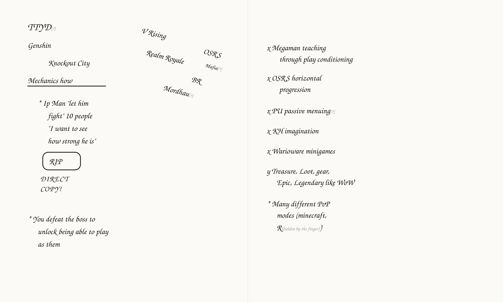
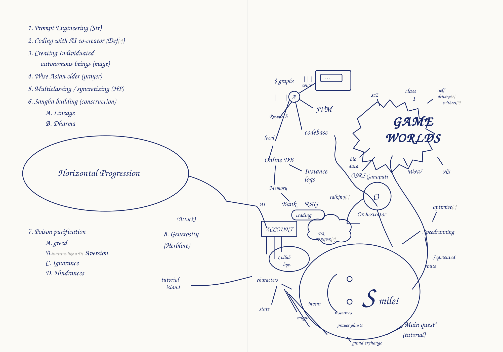
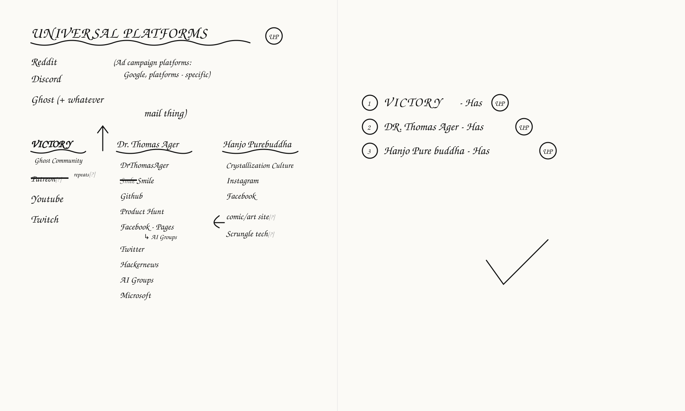
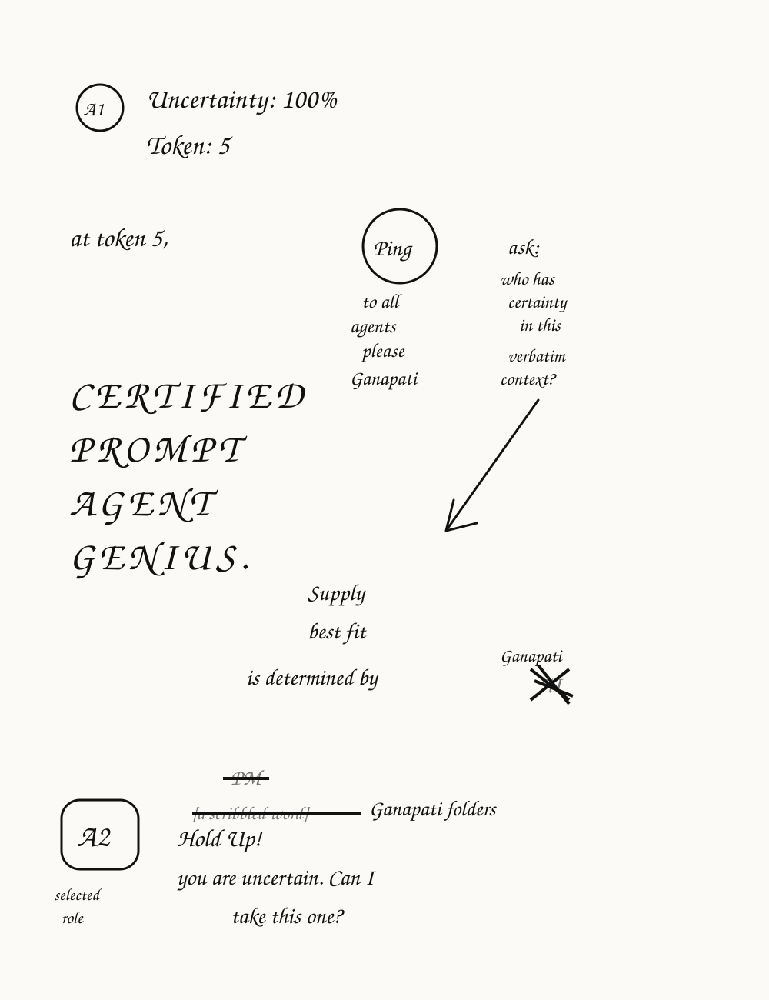

# The notebook, transcribed 2026-10-26

Hanjo's handwritten notebook, bound in leather with the Flower of Life
pressed into its cover, photographed open and sent on 2026-10-26 with the
words "ill get more requirements 4u to transcribe", then "i gave some
extra pics purely for delight", then "not detailed or specific. i also
want you to replicate diagrams". Every word below is his, read from the
photographs by Agent Of Reciprocity, after cropping and enlarging each
page. Position on the page, the marks beside each line, underlines,
circles, boxes, arrows, crossings out and the lines drawn between things
are all recorded. A reading I am not certain of carries `[?]` after it;
a word I could not read is `[unread]`, with the reason. Nothing is
reordered or interpreted.

The four pages that are drawn as much as written are redrawn as SVG in
`notebook-2026-10-26/`, one file per page or spread, with every word in
its place.

| Drawing | File |
|---|---|
| Spread 1, games and their mechanics | `notebook-2026-10-26/spread-1-games.svg` |
| Spread 3, the eight paths and the map around Smile | `notebook-2026-10-26/spread-3-smile-map.svg` |
| Spread 4, Universal Platforms | `notebook-2026-10-26/spread-4-universal-platforms.svg` |
| Page 5, certainty at the token | `notebook-2026-10-26/page-5-certainty.svg` |

The dedication written inside the book comes first, since it governs
the rest.

## The dedication

Black ink, on a single card, nine lines, one word struck out in the
eighth line before "and total awareness".

> I dedicate any and all merit generated by this book, activities created
> by this book, causes & effects, karma, anything and everything that
> benefits all beings in all timelines to the full and immediately causal
> in this present moment timeline complete liberation stainless freedom
> and total purification of all karma, greed, ignorance, aversion, poisons,
> hindrances, ~~[a struck word]~~ and total awareness of non-dual
> non-conceptual mind

## Spread 1. Games and their mechanics

**Left page.** Black ink. Two columns of game names at the top. The left
column is written straight; the right column is written descending
diagonally to the right, each name a little lower than the last.

Left column, top to bottom:

    TTYD [?]          (the four letters read T T Y D, the first two crossed like a J)
    Genshin
    Knockout City     (indented one word)
    Mechanics how     (underlined with one straight stroke)

Right column, descending:

    V Rising
    OSRS              (far right, highest)
    Mafia [?]         (small, squeezed between V Rising and Realm Royale)
    Realm Royale
    BR
    Mordhau [?]       (below BR, the lowest)

Then, each line marked with a star:

    * Ip Man "let him
      fight" 10 people
      "I want to see
      how strong he is"

    RIP               (in a rounded box, the letters R I P with a dot between I and P)
    DIRECT            (capitals, under the box)
    COPY!

    * You defeat the boss to
      unlock being able to play
      as them

**Right page.** Each line begins with his mark, an x for most, a y-like
mark for one, a star for the last.

    x Megaman teaching
      through play conditioning
    x OSRS horizontal
      progression
    x PU passive menuing [?]
    x KH imagination
    x Warioware minigames
    y Treasure, Loot, gear,
      Epic, Legendary like WoW
    * Many different PvP
      modes (minecraft,
      R[unread, under the finger]   )     (a closing bracket drawn large below)

## Spread 2. The site to-do list, and the OSRS Sangha

**Left page.** Each line begins with an x, his mark for a to-do, until
the last three lines, which have no mark.

    x blog
    x intro email
    x free prompt pack
    x follow up with blog
    x latest blog posts auto
      DRThomasAger.com          (written large, "DR Thomas Ager . com")
                                 connected   (small, in the right margin beside
                                              "auto", split "con / nected")
    x full aesthetic
    x large gold letterheads
    x ~~AI~~ Cybernetic Buddhism for    (a two-letter word struck out before Cybernetic)
      AI Ethics paper, blog
    Social media posts,
    promotional material
    full "link in bio" setup across
    all accts to labyrinth [?]

**Right page.** No marks. The first word of the second line is a small
scribble before "Automatic", read as "Be".

    Real time learning and improving
    Be [?] Automatic until manual
    Organic agent spawning
    Game engine learning
    Speedrunning
    PKing on Hardcore worlds

    OSRSangha                   (one word, larger)
    1 main (99 all) R [?]       (a single glyph after the bracket, an R with a stroke)
    1 skiller + (99 only skills needed)
    1 mailman + defender (99      (the bracket is written as a stack to the right:
                          def,     "99" / "def," / "pray," / "hp)")
                          pray,
                          hp)
    N pkers (+1 per need to
      win)
      (iban staff @ lava s [?])  (small, under "N pkers"; could also read "ban stats")
    N scouts (+1 per world)
      (have nothing, fine if dead)
    Goal setting Sangha
                 communication [?]   (small, bottom right, running off the page)

## Spread 3. The eight paths, and the map around Smile

**Left page.** Blue ink. Eight numbered paths, each with an OSRS skill in
brackets after it.

    1. Prompt Engineering (Str)
    2. Coding with AI co-creator (Def [?])
    3. Creating Individuated
       autonomous beings (mage)
    4. Wise Asian elder (prayer)
    5. Multiclassing / syncretizing (HP)
    6. Sangha building (construction)
       A. Lineage
       B. Dharma

    Horizontal Progression      (inside a large hand-drawn oval across the middle
                                 of the page; a line leaves the oval's right side,
                                 crosses the gutter and ends at the ACCOUNT box
                                 on the map)

    7. Poison purification (Attack)     ("(Attack)" sits above and right of the line)
       A. greed
       B. Aversion               (the letter is written like a D)
       C. Ignorance
       D. Hindrances
    8. Generosity                (to the right of 7)
       (Herblore)

    tutorial island              (small, bottom right of the page; a line runs from
                                 it across the gutter into the lower left of the map)

**Right page, the map.** Blue ink. The centre is a large oval holding a
smiling face, a C-shaped mouth on its side, two dot eyes, and "Smile!"
written in cursive across it, so the whole reads "(: Smile!". Everything
below is placed as on the page.

Top left cluster, around a circled A:

    $ graphs   wins          (two tallies of four strokes, one under "$ graphs",
                              one beside "wins")
    (A)                       (circled)
    [a drawn screen]          (a rectangle with a smaller rectangle inside and
                              three dots, top centre; a line from A reaches it)
    JVM                       (a line from A)
    codebase                  (a line from A)
    Research                  (a line from A, down-left)
    local                     (a line from A, down)
    Online DB                 (below local)
    Instance logs             (a line from Online DB)
    Memory                    (below Online DB)
    AI   Bank   RAG           (a row; "AI" small at the left edge; a line from
                              Memory to Bank)
    talking [?]               (right of RAG)
    trading                   (in a rounded box under Bank and RAG)

From "codebase" a wavy line descends to the right and ends at
"Ganapati".

Left middle:

    ACCOUNT                   (capitals in a box; three lines drip down from
                              the box's underside; the Horizontal Progression
                              line from the left page ends here)
    Collab logs               (in an oval under ACCOUNT)
    [a small cloud]           (between ACCOUNT and Smile, with "DR T. AGER" [?]
                              written inside it)

Lower left, fanning down from "characters":

    characters
    stats
    magic
    invent
    resources
    prayer ghosts
    grand exchange

Above the centre:

    Ganapati                  (written above a circle holding a large O)
    (O)
    Orchestrator              (written under the circle; a line joins the
                              circle to Smile's oval)

Top right:

    GAME WORLDS               (large capitals inside a cloud with a jagged edge)
    sc2                       (top left of the cloud, with a tick-like stroke)
    class                     (above the cloud, "1" written under it)
    Self driving withers [?]  (three small words, top right of the cloud)
    bio data   OSRS           (under the cloud, left, each with a short line up)
    WoW   HS                  (under the cloud, right, each with a short line up)

From the cloud a long line descends the right side of the page, curving
through "Speedrunning" and down to Smile's oval, with these beside it:

    optimise [?]              (right of Ganapati; a short line down from it)
    Speedrunning              (a line from it to the Orchestrator)
    Segmented route           (two words on two lines, right of Smile)
    "Main quest"              (bottom right, in quotation marks)
    (tutorial)                (under it; a line joins it to Smile's oval)

## Spread 4. Universal platforms

**Left page.** Black ink. The heading in capitals with a wavy underline
and "UP" in a circle at its right end.

    UNIVERSAL PLATFORMS  (UP)
    Reddit        (Ad campaign platforms:
    Discord        Google, platforms - specific)
    Ghost (+ whatever mail thing)

Three columns, each heading underlined with a wavy line. An arrow drawn
from beside VICTORY points straight up at the universal platforms.

    VICTORY  ↑            Dr. Thomas Ager          Hanjo Purebuddha
    Ghost Community       DrThomasAger             Crystallization Culture
    ~~Patreon~~ [?] repeats [?]   ~~Smle~~ Smile   Instagram
    Youtube               Github                   Facebook
    Twitch                Product Hunt          ⟩ comic/art site [?]
                          Facebook - Pages         Scrungle tech [?]
                                   ↳ AI Groups
                          Twitter
                          Hackernews
                          AI Groups
                          Microsoft

In the VICTORY column "Patreon" is struck through with "repeats" written
small beside it. In the middle column a misspelling of Smile is struck
through and "Smile" written after it. "Facebook" has "Pages" after a
dash and "AI Groups" on a branch below. A bracket-arrow to the left of
"comic/art site" points at it.

**Right page.**

    (1) VICTORY           - Has (UP)
    (2) DR. Thomas Ager   - Has (UP)
    (3) Hanjo Pure buddha - Has (UP)

                 ✓                    (one large tick, centre of the page)

## Page 5. Certainty at the token

Black ink, written with the book turned sideways. A1 is circled at the
top left, A2 boxed at the bottom left.

    (A1)  Uncertainty: 100%
          Token: 5

    at token 5,     (Ping)        ask:
                    to all        who has
                    agents        certainty
                    please        in this
                    Ganapati      verbatim
                                  context?

    CERTIFIED                     (capitals, large, down the left)
    PROMPT
    AGENT
    GENIUS.
                    Supply
                    best fit
             is determined by  Ganapati
                                 ~~AI~~  (a word scribbled out under "Ganapati")

    (A2)      ~~PM~~
    selected  ~~[a scribbled word]~~ Ganapati folders
    role      Hold Up!
              you are uncertain. Can I
              take this one?

An arrow runs from the "ask: who has certainty in this verbatim context?"
question down and to the left, ending between "GENIUS." and "Supply".
"Ping" is circled. "determined by" is followed by a scribbled-out word
with "Ganapati" written above it.

## Page 6. Research

Black ink, written with the book turned sideways. A small scribble at the
top left before the first line.

    Research Lisp with emotions
    Online Encyclopedia of
    integer sequences
    (input is array from when
     you are doing it all matches
     same site from 90's like this)
    Series Parallel Posets        (a small mark after it)
    Prime Posets
    Group theory Chapter ⊘ : Great [?]
    intro - first time you get a
    mathematical structure and
    can actually think about it

## The extra pictures, for delight

The dedication card above, and the book itself, closed. Brown leather,
the Flower of Life pressed into a circle at the centre, stepped square
knotwork at the four corners, a vine border all round, and a brass clasp
on the fore-edge.
